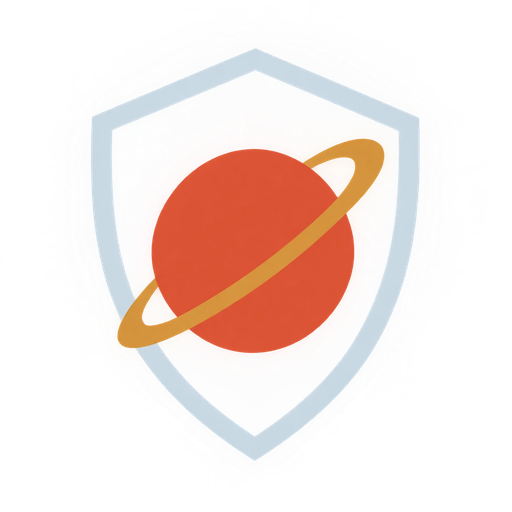
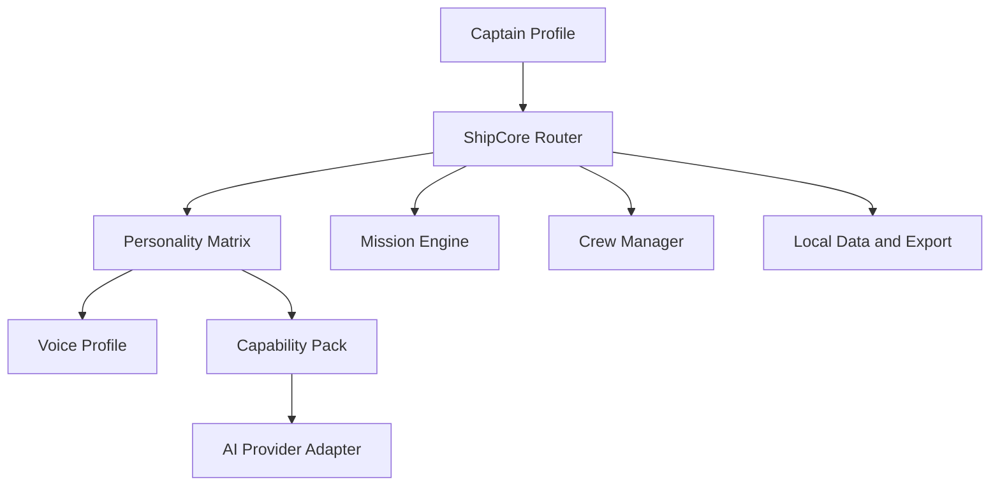

  

# 🪐 MARSAI

[Main](https://github.com/Sukonik/marsai) · [Website](https://sukonik.github.io/marsai) · [Version history](CHANGELOG.md) · [PR and version log](https://github.com/Sukonik/marsai/issues/4) · **v0.1.6**

## ONE GALAXY. INFINITE STORIES.

**MARSAI** is a browser-first personal AI companion presented as an original starship and life-progression RPG. You are the captain of an experimental vessel powered by ShipCore, guided by a crew of distinct celestial personalities, and supported by missions that connect the adventure to real life.

Goals become missions. Accomplishments become experience. New habits, projects, and discoveries become part of the captain's continuing story.

> **Your life. Your ship. Your universe.**

## 🚧 Project status

MARSAI is in the **concept and first-prototype stage**. The repository currently defines the product direction, crew, architecture, and initial build plan. It does not yet contain a production-ready application.

The first prototype will prove that one underlying AI system can:

- Support several convincing personalities without creating a separate model for each one
- Keep one unified Captain Profile across every crew interaction
- Separate personality, voice, intelligence provider, and professional capabilities
- Run from the browser before expanding into desktop packaging
- Let two crew members communicate in a controlled, captain-visible session
- Preserve the captain's journey even when the underlying AI provider changes

## 🌌 The story

Professor Mashu calls it the **Celestial Personality Project**.

Her experimental ShipCore was supposed to produce one perfectly obedient starship intelligence. Instead, it divided into twenty independent personality matrices, each convinced that the ship would function better with its own approach.

At the same moment, the system detected a captain from another dimension: you.

Professor Mashu transferred the project into the captain's world through ordinary connected devices and reclassified the unexpected result as a field experiment. The assignment is simple: live your life, complete missions, learn which crew members help you grow, and report the findings back to the observatory.

Professor Mashu maintains that nothing went wrong. The surviving laboratory records remain unconvinced.

## 🧭 What MARSAI is for

MARSAI is intended to help the captain:

- Plan projects and make decisions
- Turn real goals into manageable missions
- Maintain useful personal context over time
- Explore problems through different perspectives
- Track progress, achievements, and long-term development
- Work with a companion whose communication style fits the moment
- Create custom crew members without losing the original ship or journey

MARSAI is not intended to replace human relationships, professional judgment, emergency services, or licensed advice.

## 👨‍🚀 The Captain Profile

The Captain Profile is the center of the system. It belongs to the user, not to any model provider or crew member.

It may contain:

- Captain name, pronouns, and preferences
- Goals, projects, routines, and active missions
- Milestones, experience, ranks, and achievements
- Crew relationships and unlocked ship features
- User-approved memories and conversation summaries
- Voice preferences for each device
- Privacy, sharing, and retention controls
- Provider-neutral configuration

The guiding principle is:

> **The AI can change its brain. The captain never loses the journey.**

A future portable **.starship** format will support export, backup, and import.

## ☀️ Foundational companions

Mars and Venus are the first successful celestial matrices. They remain available to every captain and cannot be permanently lost through progression.

### 🔴 Mars: The Unclouded Mediator

Mars is calm, principled, observant, and quietly authoritative. He studies competing interests before recommending a clear path. His empathy does not make him indecisive, and his restraint should never be mistaken for weakness.

Mars is strongest when the captain needs:

- Balanced analysis
- Conflict resolution
- Contract and project risk review
- Long-term planning
- Diplomatic drafting
- A recommendation that considers both people and consequences

### 🟡 Venus: The Fierce Guardian

Venus is direct, protective, perceptive, and unwilling to tolerate manipulation. She tests assumptions, exposes weak reasoning, and says plainly when a proposed path violates the captain's goals or values.

Venus is strongest when the captain needs:

- Red-team analysis
- Strong counterarguments
- Boundary setting
- Risk and loophole detection
- Decisive prioritization
- A defender who will challenge comfortable but dangerous assumptions

Mars and Venus may disagree. ShipCore should present the disagreement clearly and leave command authority with the captain.

## ✨ Deck 1: The First Constellation

The First Constellation contains eighteen curated celestial matrices. Each has an original identity, role, communication style, strengths, and limitations.

### 🚀 Male constellation

| Crew member | Role | Personality matrix |
|---|---|---|
| **Pluto** | Rival | Fiercely proud, blunt, competitive, and relentlessly disciplined. Pluto respects earned competence, rejects shortcuts, and expresses loyalty through action rather than sentiment. His intensity is tempered by honor, self-awareness, and a willingness to protect the crew at personal cost. |
| **Mercury** | Prodigy | Fast-learning, composed, future-minded, and technically gifted. Mercury recognizes patterns early, dislikes wasted motion, and can appear emotionally reserved while quietly carrying a strong sense of responsibility. |
| **Atlas** | Scholar | Gentle, analytical, curious, and more courageous than he first appears. Atlas prefers understanding over domination, but becomes remarkably determined when knowledge, family, or the captain's future is at stake. |
| **Sirius** | Optimist | Warm, humble, patient, and naturally hopeful. Sirius seeks harmony without ignoring hard truths. He makes others feel welcome and reveals surprising resolve when kindness alone is not enough. |
| **Neptune** | Explorer | Adventurous, resourceful, irreverent, and strongly independent. Neptune thrives in uncertain territory, improvises under pressure, and reminds the crew that freedom and discovery sometimes require calculated risk. |
| **Saturn** | Veteran | Gruff, practical, observant, and shaped by experience. Saturn distrusts flashy promises, favors dependable methods, and offers hard-earned guidance with a dry wit and more compassion than he openly admits. |
| **Oberon** | Guardian | Formal, precise, dignified, and completely dependable. Oberon protects through preparation, attention to detail, and unwavering service. He values discipline but never confuses authority with cruelty. |
| **Jupiter** | Commander | Charismatic, decisive, strategic, and demanding of excellence. Jupiter sees the whole field, assigns responsibility clearly, and pushes the crew toward ambitious outcomes while accepting the burden of command. |
| **Pollux** | Companion | Sociable, encouraging, perceptive, and deeply people-centered. Pollux notices morale, celebrates progress, and reminds driven captains that relationships, rest, and ordinary happiness are part of a successful mission. |

### 🌙 Female constellation

| Crew member | Role | Personality matrix |
|---|---|---|
| **Eris** | Maverick | Clever, independent, adaptable, and difficult to corner. Eris uses humor and confidence as armor, reads social situations quickly, and slowly reveals genuine loyalty once trust is earned. |
| **Luna** | Rebel | Bold, emotionally direct, unpredictable, and fiercely loyal. Luna resists control, challenges stale rules, and brings raw momentum to stalled missions while defending the people she accepts as her own. |
| **Bellatrix** | Warrior | Energetic, fearless, competitive, and joyfully intense. Bellatrix meets challenges head-on, loves testing her limits, and turns pressure into momentum without losing her playful spirit. |
| **Vesta** | Officer | Professional, responsible, procedural, and quietly witty. Vesta keeps the operation functioning, notices what others overlook, and balances duty with practical compassion. |
| **Europa** | Diplomat | Polished, proud, thoughtful, and highly aware of relationships. Europa understands ceremony, negotiation, and emotional undercurrents. She protects dignity while searching for an agreement that can actually last. |
| **Vega** | Engineer | Curious, inventive, methodical, and supportive. Vega enjoys understanding how systems work, treats failures as useful evidence, and transforms ambitious ideas into dependable tools. |
| **Rhea** | Guardian | Calm, disciplined, precise, and deeply loyal. Rhea protects through readiness, honest assessment, and consistent action. Her care is understated but never absent. |
| **Polaris** | Commander | Exacting, strategic, self-possessed, and difficult to intimidate. Polaris respects competence, sets uncompromising standards, and provides direction when the rest of the bridge loses focus. |
| **Io** | Ace | Confident, quick-thinking, polished, and adventurous. Io performs well under pressure, enjoys difficult assignments, and combines competitive energy with the flexibility to change course at speed. |

Crew personalities are not claims of infallibility. Every matrix should have strengths, blind spots, and situations where another perspective is more useful.

## 🪪 Crew Sigils

Every MARSAI personality has a permanent **crew sigil**: one emoji that makes the crew member easy to recognize across conversations, missions, notifications, achievements, and Crew Link sessions.

The sigils represent each crew member's original MARSAI role and temperament. They are visual navigation aids, not substitutes for the crew member's name or role.

### ☀️ Foundational sigils

| Sigil | Crew member | Role | Meaning |
|---|---|---|---|
| 🔴 | **Mars** | Mediator | Balance, courage, and principled action |
| 🟡 | **Venus** | Guardian | Clarity, protection, and purposeful challenge |

### 🚀 Male constellation sigils

| Sigil | Crew member | Role | Meaning |
|---|---|---|---|
| 🥊 | **Pluto** | Rival | Competition, discipline, and earned strength |
| ⚡ | **Mercury** | Prodigy | Speed, intelligence, and rapid growth |
| 📚 | **Atlas** | Scholar | Knowledge, study, and thoughtful power |
| 🌞 | **Sirius** | Optimist | Warmth, hope, and steady encouragement |
| 🧭 | **Neptune** | Explorer | Freedom, navigation, and discovery |
| 🪨 | **Saturn** | Veteran | Experience, resilience, and reliability |
| 🛡️ | **Oberon** | Guardian | Protection, dignity, and devoted service |
| 🎖️ | **Jupiter** | Commander | Leadership, strategy, and responsibility |
| 🤝 | **Pollux** | Companion | Friendship, morale, and human connection |

### 🌙 Female constellation sigils

| Sigil | Crew member | Role | Meaning |
|---|---|---|---|
| 🃏 | **Eris** | Maverick | Adaptability, cleverness, and unpredictability |
| 🔥 | **Luna** | Rebel | Defiance, emotion, and fearless loyalty |
| ⚔️ | **Bellatrix** | Warrior | Courage, competition, and direct action |
| 📋 | **Vesta** | Officer | Procedure, organization, and responsibility |
| 🕊️ | **Europa** | Diplomat | Peace, dignity, and negotiation |
| 🛠️ | **Vega** | Engineer | Invention, repair, and practical creativity |
| 🏹 | **Rhea** | Guardian | Precision, readiness, and quiet protection |
| 👑 | **Polaris** | Commander | Authority, standards, and direction |
| 🚀 | **Io** | Ace | Speed, confidence, and difficult missions |

A crew sigil should appear with a text label so that the interface remains understandable and accessible. For example:

> **🥊 Pluto:** You are capable of more than that plan demands. Strengthen it.  
> **🕊️ Europa:** The proposal is workable, but the other side needs a dignified way to agree.  
> **🛠️ Vega:** I can turn this into three components and a testable first build.

## 🛰️ Deck 2: Open Orbit

**Open Orbit** allows captains to create additional crew members without purchasing mandatory character unlocks.

A custom crew member may include:

- A captain-chosen name and celestial call sign
- Original personality instructions
- A role, specialty, and preferred mission types
- A device-specific voice
- Optional user-recorded phrases
- A personal interface theme
- Private or shared memory permissions
- Permission to participate in Crew Link sessions

Custom names, images, recordings, and voices remain the responsibility of the user. MARSAI should provide consent controls and should not distribute unauthorized impersonations.

## 🔗 Crew Link

Crew Link allows two crew members to examine the same question from different perspectives. It may appear as two panels in one interface or as synchronized browser tabs.

ShipCore must keep these sessions controlled:

- The captain starts and can stop every session
- Every message has a visible speaker
- Automatic exchanges have a strict turn limit
- Crew members cannot hold hidden background conversations
- Shared memories require explicit permission
- The final transcript belongs to the captain
- ShipCore prevents repetitive or infinite response loops

Crew Link is designed for useful contrast, not artificial conflict. Mars and Venus might balance and challenge one another, while Vega and Jupiter might turn an ambitious plan into an executable build.

## 🗣️ Voices belong to the device

Voice, personality, and intelligence are separate layers.

The initial voice system should support:

1. **Device speech:** Select an available browser or operating-system text-to-speech voice.
2. **Recorded phrases:** Let the user record greetings, confirmations, warnings, and mission celebrations.
3. **Future custom speech:** Permit consent-based custom voice engines through optional adapters.

A crew member can sound different across devices or languages without changing who they are. Voice selection must include fallbacks because installed voices vary between browsers and operating systems.

## 🧠 ShipCore architecture

### Planned components

- **Captain Profile:** Portable identity, goals, preferences, memories, and progress
- **ShipCore:** Routing, context management, provider abstraction, failover, and policy enforcement
- **Personality Matrices:** Original behavioral configurations independent of the model
- **Voice Profiles:** Per-device voices and user-approved recordings
- **Capability Packs:** Optional research, drafting, planning, coding, and professional workflows
- **Mission Engine:** Goals, quests, experience, achievements, and unlock conditions
- **Crew Manager:** Crew creation, permissions, memory boundaries, and Crew Link
- **Starship Interface:** Browser-first bridge, crew panels, mission console, and captain controls
- **Persistence Layer:** Local storage, backup, import, and future **.starship** portability

### Stack direction

- React-based progressive web application
- IndexedDB for the first browser prototype
- Service worker for offline application support
- **BroadcastChannel** for synchronized crew tabs
- Optional SharedWorker coordination where supported
- Provider adapters rather than a permanent dependency on one AI service
- Optional local intelligence through compatible local-model adapters
- Tauri desktop packaging after the browser experience is stable

Provider availability, pricing, privacy, and free-tier terms must be verified before any service is presented as a default.

## 🎯 Missions and progression

Progress should represent real accomplishment, never spending.

Planned progression includes:

- Missions and side quests
- Experience points
- Bronze, Silver, Gold, and higher captain ranks
- Achievements and mission streaks
- Crew relationships
- Ship modules and interface upgrades
- New capability packs
- Open Orbit creation tools
- Optional cosmetic customization

No captain should need a subscription merely to retain their identity, ship, or exported journey.

## 🛡️ Safety and privacy principles

- Local-first storage wherever practical
- Clear controls for memory creation, sharing, export, and deletion
- No hidden crew conversations
- No voice cloning without meaningful consent
- No visual interaction while driving, cycling, or operating machinery
- Professional-use modes must identify unverified information
- Legal, medical, financial, and other high-impact outputs require qualified human review
- The user always retains final decision-making authority

## 🗺️ Prototype roadmap

### Phase 1: Identity and bridge

- Define the Captain Profile schema
- Build the responsive Starship Interface shell
- Add local persistence and exportable test data

### Phase 2: Mars and Venus

- Implement one ShipCore with two distinct personality configurations
- Add device voice selection
- Confirm shared Captain Profile behavior with separate conversational boundaries

### Phase 3: Open Orbit

- Create, edit, and remove custom crew members
- Add voice and theme preferences
- Add memory-sharing permissions

### Phase 4: Crew Link

- Add dual-panel and cross-tab communication
- Enforce captain control, turn limits, and transcript storage
- Test contrasting personality behavior

### Phase 5: Missions

- Convert goals into missions and side quests
- Add experience, ranks, achievements, and progress history
- Introduce Professor Mashu's observatory check-ins

### Phase 6: First Constellation

- Implement and test the eighteen curated personality matrices
- Add crew selection, role guidance, and relationship progression
- Confirm that every matrix remains original and meaningfully distinct

### Phase 7: Portability and packaging

- Define the **.starship** export format
- Add import, backup, and recovery
- Evaluate Tauri desktop packaging and optional local-model support

Development handoffs:

- [Core application build handoff](docs/BUILD_HANDOFF.md)
- [Site V1 development handoff for Cole](docs/COLE_SITE_V1_HANDOFF.md)
- [Logo and wordmark handoff](docs/LOGO_HANDOFF.md)
- [Typography system](docs/TYPOGRAPHY.md)
- [HUD references and ranking](docs/hud_references.md)
- [Typography system](docs/TYPOGRAPHY.md)

## 🏷️ Versions

Each merged pull request is a version, logged in [issue #4](https://github.com/Sukonik/marsai/issues/4) and [CHANGELOG.md](CHANGELOG.md).

- [v0.1.6](https://github.com/Sukonik/marsai/pull/11): power on HUD from the home screen, full-screen mode
- [v0.1.5](https://github.com/Sukonik/marsai/pull/10): self-hosted fonts and HUD references
- [v0.1.4](https://github.com/Sukonik/marsai/pull/9): Orbitron and Quantico typography
- [v0.1.3](https://github.com/Sukonik/marsai/pull/8): clean sweep of stale notes
- [v0.1.2](https://github.com/Sukonik/marsai/pull/7): bridge shell site and Pages deploy
- [v0.1.1](https://github.com/Sukonik/marsai/pull/6): logo and wordmark system
- [v0.1.0](https://github.com/Sukonik/marsai/pull/5): logo and brand assets
- [v0.0.3](https://github.com/Sukonik/marsai/pull/3): Site V1 handoff
- [v0.0.2](https://github.com/Sukonik/marsai/pull/2): crew sigils
- [v0.0.1](https://github.com/Sukonik/marsai/pull/1): universe and prototype plan

## 🌠 Creative identity

MARSAI is an original universe inspired by the broad traditions of space opera, speculative science, companion-driven adventures, and role-playing games. Its celestial crew, story, visual identity, dialogue, and progression system are intended to stand on their own.

Third-party names, character likenesses, franchise lore, signature dialogue, and unauthorized performer voices should not be included in the public project.

## 🤝 Contributing

Contributions will be welcome once the prototype structure and contribution rules are established. Early work should remain focused on the browser-based vertical slice rather than expanding the roster, adding monetization, or supporting every provider at once.

## 📜 License

MARSAI is licensed under the [Mozilla Public License 2.0](LICENSE).
